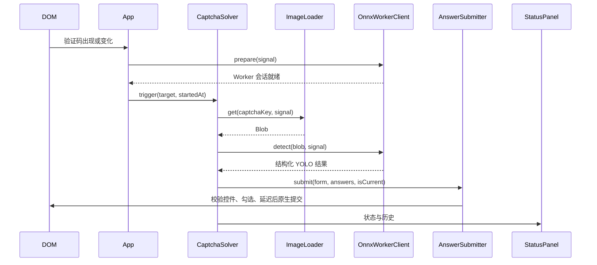

# 浏览器核心与用户脚本架构

本文说明 DOM、答案、Worker 和面板的状态所有权。安装与设置见[用户脚本指南](../usage/userscript.md)和[共享行为](../usage/settings.md)，跨上下文实现见[扩展运行时](extension-runtime.md)。核心通过入口注入平台能力，不直接调用 GM 或 WebExtension API。

## 状态所有权

| 对象                       | 拥有的状态                                     | 结束条件                                 |
| -------------------------- | ---------------------------------------------- | ---------------------------------------- |
| App                        | 当前/准备中/失败目标、页面取消信号、凭证修订号 | 新目标、切页、Key 变化或销毁使旧任务失效 |
| CaptchaSolver              | 一轮图片获取、识别、结果与耗时                 | 仅当前目标可记录完成或进入提交           |
| AnswerSubmitter            | 控件快照、自动勾选归属                         | 每次点击及最终提交前重查目标与归属       |
| OnnxWorkerClient           | 会话、初始化、串行检测队列                     | 取消、超时恢复或销毁释放请求与 Worker    |
| StatusPanel / HistoryStore | 面板节点、渲染代际、历史追加及持久化           | 迟到写入不得复活销毁节点或覆盖新状态     |

## 组装路径

用户脚本 [main.ts](../../apps/userscript/src/main.ts) 在 DOM 就绪后初始化，非 BFCache 的 `pagehide` 销毁应用。入口 App 继承[核心 App](../../packages/browser-core/src/app/app.ts)，接入 `createAppDependencies` 的信号所有者。

依赖组装位于 [apps/userscript/src/app/app-dependencies.ts](../../apps/userscript/src/app/app-dependencies.ts)：

```text
App
 ├─ StatusPanel(HistoryStore, gmSettingsStorage)
 ├─ ModelCache(用户脚本 downloadModel)
 ├─ OnnxWorkerClient(Blob Worker factory)
 ├─ CachedImageLoader
 ├─ AnswerSubmitter(设置存储提供的延迟)
 └─ CaptchaSolver(panel, detector, imageLoader, submitter, answer mode, abort signal)
```

平台接缝由 [AppDependencies](../../packages/browser-core/src/app/app-dependencies.ts)、[DetectorService](../../packages/browser-core/src/inference/inference-types.ts)、[面板契约](../../packages/browser-core/src/status-panel/status-panel-types.ts)和[存储接口](../../packages/browser-core/src/platform/storage.ts)定义；新增能力先确认接口归属。

## 验证码生命周期与取消

[App](../../packages/browser-core/src/app/app.ts) 在 documentElement 上观察验证码相关变化，以启动延迟和 MutationObserver 防抖调度扫描，覆盖 body 替换和暂时缺失。扫描与面板各自维护观察器；App 保存当前、失败和准备中的目标，在销毁、切页或 Key 变化时取消旧任务或推进凭据修订号。

JPX 的 `AjaxRound` 会批量清除页面定时器，留下失效的待扫描句柄。每次相关 mutation 都重挂定时器，保留基于 `performance.now()` 的原扫描截止时间；已过期则立即排队，不再等待完整 100ms，持续变化也不延后截止时间。无关 mutation 不重挂，去重、失败冷却与销毁约束不变；这不是全页定时器保护或轮询恢复。

目标变化或移除时，取消不等待防抖：先比较完整 `CaptchaTarget` 并取消旧信号，再扫描最新目标。`prepareTarget()` 通过 `raceAbort` 释放等待，底层准备 Promise 迟到结算不能阻塞新轮次、重试旧目标或写入旧结果。无关子节点变化和提交按钮启用不取消同一目标的初始化，已完成目标仍去重。

图片快照同时保存解析后的 `src`、`srcset`、`sizes` 和 `picture` 的 source 身份及属性；选源声明变化即令旧轮次失效，不能只比较 `currentSrc`。响应式图片等待 `complete` 和 `currentSrc`，不回退旧 `src`；App 捕获图片 `load/error` 后补扫，覆盖选源完成但没有新 DOM mutation 的情形。销毁时移除监听，迟到加载不重启应用。

答题模式、提交延迟和多选延迟的异步设置读取受取消信号与 `inferenceTimeoutConfig.settingsReadTimeoutMs` 约束：模式读取最多 5 秒，两种延迟并行读取合计最多 5 秒。预先取消不发起读取；取消或超时释放 Solver 等待，迟到成功或拒绝不能重新点击、提交或写历史。这只结束调用方等待，不宣称撤销 GM 已发起的存储操作。

一次自动处理的主链路是：



`CaptchaTarget` 在模型准备前捕获解析后的 `form.action`、原生提交控件的实际 action 与类型。`App` 和 `CaptchaSolver` 贯穿准备、图片、推理、提交阶段用 `isSameCaptchaTarget` 复核；相对与绝对写法解析到同一 URL 时等价。取消、超时或新目标使旧任务停止点击。

[AnswerSubmitter](../../packages/browser-core/src/captcha/answer-submitter.ts) 在开始、等待后及每次点击前后复核地址、checkbox 数量/类型/身份、所属表单、连接与有效禁用状态；`formaction` 不能绕过同源检查，`fieldset` 继承禁用包含首个 `legend` 例外。手动模式只记录结果，随机兜底由 [CaptchaSolver](../../packages/browser-core/src/captcha/captcha-solver.ts) 配置。

保留答案依靠 WeakMap 与 `change` 监听维护归属：

- 仅本轮实际点击成功或原有自动标记的项可更新置信度；候选中的手动项不会被接管，后续轮次合并也保留其身份。
- 模型准备前捕获手动变更基线；本轮手动取消项在初始裁剪前排除，每次自动勾选前再复核，贯穿图片读取、推理和等待。下一轮重取基线，关闭保留模式则接管选择。
- 合计不超过 4 项时保留，超过时只从自动项按低置信度裁剪至最多 3 项，或直到无自动项。提交等待后按实时状态再次裁剪，始终保留手动项。
- 初始和最终裁剪每次点击前都重查自动归属，防止上一项的 `change` 回调把下一项变为手动后仍被清除。

## 推理 Worker 与 Runtime profile

[OnnxWorkerClient](../../packages/browser-core/src/inference/onnx-worker-client.ts) 管理初始化共享、串行检测、超时恢复、会话重建和销毁，`WorkerFactory` 由平台注入。取消立即移除未开始项并释放图片；活动项完成或取消宽限到期终止后才执行下一项。销毁立即拒绝全部排队项。

[Worker 入口](../../packages/browser-core/src/inference/onnx-worker-entry.ts) 验证 `unknown` 请求，初始化 Runtime，复用 OffscreenCanvas/CHW 缓冲并执行 WASM 推理；[request bridge](../../packages/browser-core/src/inference/worker-request-bridge.ts) 验证结构化响应、管理 request id 与超时。

用户脚本的 [onnx-worker-client.ts](../../apps/userscript/src/inference/onnx-worker-client.ts) 注入 [blob-worker.ts](../../apps/userscript/src/inference/blob-worker.ts) 创建的 Worker，并把构建时内联的脚本文本交给它。两个入口分别是：

- [onnx-worker-external-entry.ts](../../apps/userscript/src/inference/onnx-worker-external-entry.ts)：有界下载、校验外置 Runtime JS/WASM，校验成功后才通过 `importScripts`，并限制启动排队请求数。
- [onnx-worker-bundled-entry.ts](../../apps/userscript/src/inference/onnx-worker-bundled-entry.ts)：使用构建时提供的 Runtime glue，再通过 [runtime-wasm-loader.ts](../../apps/userscript/src/inference/runtime-wasm-loader.ts) 校验 Runtime WASM。

构建脚本 [build-userscript.mjs](../../apps/userscript/scripts/build-userscript.mjs) 选择 profile、把 Worker bundle 内嵌到主脚本、从 metadata 模板注入包版本，并可输出构建清单。资产身份和 profile 约束以 [onnx-runtime-assets.mjs](../../apps/userscript/scripts/onnx-runtime-assets.mjs) 与 [docs/onnx-runtime.md](../onnx-runtime.md) 为准，本文不重复具体数值。

## 模型下载、缓存和存储

图片、模型与 Runtime 共用 `readBoundedByteStream`：已知长度分配最终缓冲，未知长度在上限内倍增并即时复制，结束只返回实际字节，不积累分块或外部大缓冲视图。增长/裁剪时新旧缓冲可能并存，字节上限不是进程内存上限。HTTP/头校验失败后尽力清理流，不等待取消 Promise；清理抛错、拒绝或挂起不能阻塞图片回退或覆盖原始错误。

核心[下载器](../../packages/browser-core/src/model/model-downloader.ts) 负责 Bearer、重定向拒绝、状态、有界读取、完整性及回执；用户脚本[适配器](../../apps/userscript/src/model/model-downloader.ts) 只提供 Key 并组合调用方/超时信号。

[ModelCache](../../packages/browser-core/src/model/model-cache.ts) 编排读取、共享下载、写入与确认；[IndexedDB store](../../packages/browser-core/src/model/indexeddb-model-store.ts) 管理事务，[record](../../packages/browser-core/src/model/model-cache-record.ts) 校验记录，[shared downloads](../../packages/browser-core/src/model/shared-model-downloads.ts) 合并并发下载。带回执的模型与待确认元数据同事务落盘，确认并更新匹配元数据后才允许后续缓存命中；无回执不确认。关闭或 `versionchange` 取消数据库操作与共享下载。

用户脚本 Key 经 [model-settings.ts](../../apps/userscript/src/model/model-settings.ts) 存入 [sensitiveGmSettingsStorage](../../apps/userscript/src/userscript/gm-storage.ts)，GM 不可用时拒绝降级到页面存储。实际提交后才通知组装层，取消并等待旧 prepare 后恢复 App；已就绪会话复用，并发按修订号取最新。取消输入、验证/存储失败或销毁后的迟到回调不恢复。

保存和读取只去除 Key 首尾空白，保留验证过的原始大小写，以兼容历史 KV 条目；额度身份仍由服务端规范化。已经丢失大小写的旧存储值无法反推，需重新输入原 Key。

普通设置用 `gmSettingsStorage`；历史适配器 [answer-history-store.ts](../../apps/userscript/src/persistence/answer-history-store.ts) 注入 `userscriptHistoryStorage`，无缓存枚举同源 localStorage 前缀。先取 key 快照，跳过其他标签已删除值；新记录独立键追加，有效旧根只读兼容，禁止整根 JSON 读改写。每世界读取最多 50 条，稳定追加后裁剪；并发可暂时多存，旧根仍可保留。

缓存策略、`GET /quota`、`POST /quota`、确认时机和 `no-store` 约束请只在[模型缓存专题](../model-cache-strategy.md)维护。不要在平台适配器中复制额度或缓存状态机。

## 状态面板与历史

[StatusPanel](../../packages/browser-core/src/status-panel/status-panel.ts) 管理状态、历史代次、异步设置与 `div#csp` 可见性；[renderer](../../packages/browser-core/src/status-panel/status-panel-renderer.ts) 只用安全 DOM API，不引入 `innerHTML` 或动态执行。持久化先乐观显示，失败后回滚到已保存历史并报错。破坏性裁剪只使用异步存储的 `getCommittedItemsByPrefix()` 已提交快照，未决写入不挤掉旧记录；快照失败则跳过删除，同步存储仍普通枚举。

面板观察器独立于 csp 开关，观察 documentElement 下 body 及子节点。首次初始化也允许 body 缺失，先注册观察、等待插入，不因面板尚未挂载而中止 App 启动。AADB 等脚本移除 `.ponyLog` 后挂回原节点，不重建应用或重读历史。渲染先复核挂载，再命中缓存或消费自身 mutation，避免遗漏外部移除。destroy 断开观察并清空引用，迟到回调不能复活面板。

[HistoryStore](../../packages/browser-core/src/persistence/answer-history-store.ts) 在写入前分配每世界的正安全整数 `sequence`：本实例已分配与当前可见序号的最大值加一，失败可留空洞，重建后从已保存记录恢复。独立键按序号、时间戳、稳定 key 排序裁剪；未互相可见的并发写可同序号，再以后二者排序。非法序号视为损坏，上限耗尽走保存失败通道。无序号旧记录按原时间戳读取，非枚举旧数组保留原顺序；显示用 `timestamp`/`time` 不单调化，旧数据不重写。

App 在 `prepareTarget()` 前用 `performance.now()` 取开始时间，与手动变更快照经 `SolverService.trigger(target, startedAt, signal, answerSelection)` 传给 Solver。历史 `elapsed` 含准备与重试，自动模式截至提交点击，手动模式截至结果记录；不含扫描前加载/防抖或提交后响应。Solver 独立统计图片获取和识别耗时，仅当前目标可写“完成 Nms”。OnnxWorkerClient 初始化/推理及扩展 RemoteDetectorClient 初始化往返也用单调时钟，统一整数毫秒；历史时刻用 `Date.now()`，旧值不补算。回归须覆盖重试、校时、目标重置、取消与 DOM 替换。

用户脚本[面板适配器](../../apps/userscript/src/status-panel/status-panel.ts) 只注入历史和 GM 设置。默认值变化须联动 [panel-settings.ts](../../packages/browser-core/src/status-panel/panel-settings.ts)、两平台设置、面板测试与使用说明。

## 目录导航

核心 `src/` 按 `app`、`captcha`、`inference`、`model`、`persistence`、`platform`、`status-panel`、`utils` 分组，测试镜像同名目录。用户脚本在对应领域放薄适配器，GM 桥接、菜单和 metadata 归 `src/userscript`，构建与资产检查归 `scripts/`。完整目录见[目录规则](../development/directory-layout.md)。

[index.ts](../../packages/browser-core/src/index.ts) 只聚合公共接口；子路径以 [package exports](../../packages/browser-core/package.json) 为准。新增实现放领域目录，平台判断放适配器，不堆进聚合入口。

## 测试地图与验证边界

核心和用户脚本测试目录按源码领域镜像组织。核心 `vitest` 默认使用 jsdom；用户脚本 `vitest` 也使用 jsdom，脚本门禁另由 Node test 执行。用户脚本唯一的 Playwright 浏览器目录是 `test/e2e`，当前配置只声明 Chromium 项目；这不能证明 Firefox、不同用户脚本管理器或真实 Model Worker 的行为。

| 变更                     | 最小测试                                                                                   | 还应关注                                          |
| ------------------------ | ------------------------------------------------------------------------------------------ | ------------------------------------------------- |
| App 调度、目标替换、销毁 | `browser-core/test/app`, `userscript/test/app`                                             | `CaptchaSolver`、E2E smoke                        |
| 勾选、保留答案、原生提交 | 两个包的 `test/captcha/answer-submitter.test.ts`                                           | 表单替换和取消场景                                |
| Worker 协议、超时、恢复  | 两个包的 `test/inference`                                                                  | 用户脚本 Blob Worker 与两个 Runtime 入口          |
| 下载、完整性、缓存事务   | `browser-core/test/model`、`userscript/test/model`                                         | `docs/model-cache-strategy.md`、Model Worker 契约 |
| GM 存储和设置菜单        | `userscript/test/userscript`                                                               | 敏感 Key 不落到 page-readable storage             |
| 面板和历史               | 两个包的 `test/status-panel` 与 `test/persistence`                                         | csp 可见性、重新挂载、异步设置和持久化失败        |
| 构建/metadata/资产       | `apps/userscript/scripts/*test.mjs`、`apps/userscript/test/userscript-build-smoke.test.ts` | 构建产物审计和包体预算                            |

常用验证命令：

```bash
mise exec -- pnpm --filter @hv-pony-solver/browser-core test
mise exec -- pnpm --filter @hv-pony-solver/userscript test
mise exec -- pnpm --filter @hv-pony-solver/browser-core typecheck
mise exec -- pnpm --filter @hv-pony-solver/userscript typecheck
mise exec -- pnpm docs:check
```

上述测试主要证明模拟 DOM、Worker、Fetch、存储和构建门禁；它们不自动证明真实页面、真实 GM 管理器、真实远程模型鉴权或浏览器多引擎兼容性。涉及这些边界时，在报告中单独列出已运行的 E2E 和未覆盖项。

## 推理参数权威入口

[inference-config.ts](../../packages/browser-core/src/inference/inference-config.ts) 是以下参数的唯一源码来源，调用者不得另设隐式常量：

| 配置                     | 字段与当前行为                                                                                                                                                     |
| ------------------------ | ------------------------------------------------------------------------------------------------------------------------------------------------------------------ |
| `imagePreprocessConfig`  | `imageSize=640`；图片编码最多 2 MiB，边长最多 4096，像素最多 16000000                                                                                              |
| `yoloOutputConfig`       | `rowSize=6`、`confidenceIndex=4`、`classIndex=5`；`confidenceThreshold=0.3`、`maxDetections=16`、`maxKinds=3`；输出最多 100000 行                                  |
| `inferenceTimeoutConfig` | `workerInitTimeoutMs=60000`、`workerDetectTimeoutMs=30000`、`modelDownloadTimeoutMs=30000`、`settingsReadTimeoutMs=5000`；取消宽限、探测和缓存超时同样由该对象维护 |
| `prepareDeadlineConfig`  | Worker、内容端与 Broker 的期限逐层留出结算余量；扩展协议不能复制另一份期限                                                                                         |

输入在浏览器内转换为 640×640 CHW Float32，YOLO 输出映射到 shared 的答案码。修改参数后同时核对预处理、输出 guard、两平台 Worker 和截止时间测试。

## 维护入口

新增平台能力先调整核心接口，再在平台入口组装；薄适配器不是仅凭行数即可删除的重导出。涉及取消或并发时先锁定状态所有者，补行为回归，再拆分模块。注释、类型、格式和导出规范统一见[贡献指南](../development/contributing.md)，避免各架构页维护不同规则。
