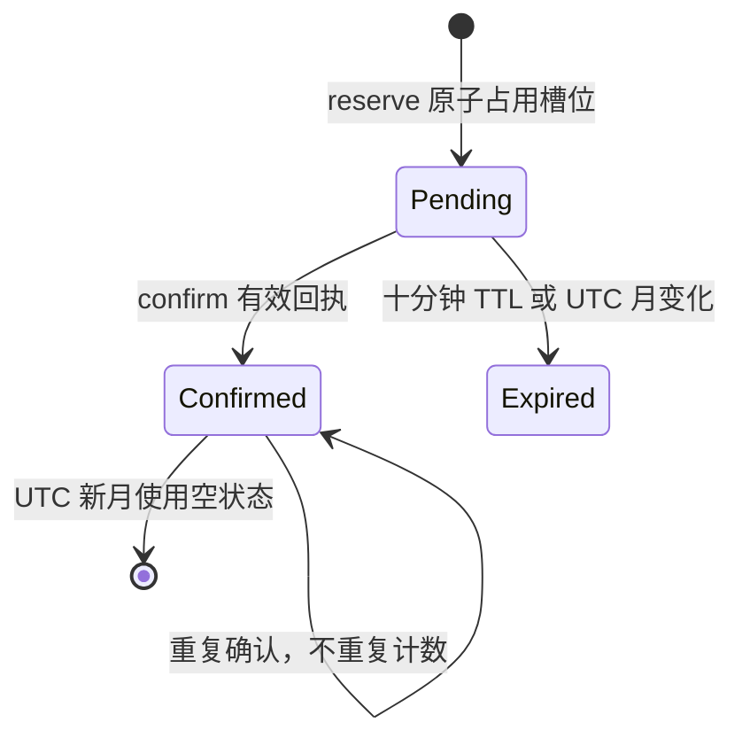

# Model Worker 与共享契约

Model Worker 负责 Key 鉴权、模型/运行时分发和每 Key 下载额度，不接收验证码或答案。本文解释组件、请求顺序和持久状态；方法与响应头见 [HTTP 契约](../reference/model-worker-http.md)，客户端事务见[缓存策略](../model-cache-strategy.md)，部署见[运维手册](../model-worker-ops.md)。

## 组件边界与目录

| `apps/model-worker/` 路径                 | 职责                                           |
| ----------------------------------------- | ---------------------------------------------- |
| `src/index.ts`                            | Worker fetch 入口、`ModelDownloadQuota` 类导出 |
| `src/request-router.ts`                   | 路由匹配、方法分支和请求编排                   |
| `src/model-access.ts`                     | Bearer 解析、规范化 Key 和 KV 授权             |
| `src/model-response.ts`                   | 响应头、CORS、缓存与错误响应                   |
| `src/asset-integrity.ts`                  | R2 长度和 SHA-256 元数据预检                   |
| `src/model-download-quota.ts`             | 额度 Durable Object、状态校验及调用客户端      |
| `src/env.ts`、`src/worker-types.ts`       | 配置解析、校验、缓存与最小绑定接口             |
| `src/request-timeout.ts`、`src/logger.ts` | KV/R2/DO 超时与脱敏分类日志                    |
| `test/`、`scripts/`                       | Worker 测试、配置渲染/校验和部署探测           |

Worker 只从 `packages/shared` 消费纯契约；R2、KV、DO 和请求对象留在 Worker 内部。shared 不依赖 DOM、扩展、GM 或 Cloudflare API，入口和领域子路径均使用显式 package exports。

## 请求入口与路由

`worker.fetch` 委托 `handleRequest`：读取并校验配置，按完整 pathname 精确匹配旧 ONNX、ORT、额度或公开 WASM 路由，再处理 OPTIONS、方法限制和业务请求。未知路径返回 404，方法不符返回带 `Allow` 的 405；具体矩阵见 [HTTP 参考](../reference/model-worker-http.md#响应矩阵)。

OPTIONS 不做 Key/额度操作。模型和额度使用受限来源策略，WASM 成功响应和预检使用公开策略。顶层异常返回通用 500；日志只记路由和错误类别，不回显 Key、摘要、对象身份或底层错误文本。`Error.name` 也按不可信数据处理，仅保留固定错误名称；自定义名称或抛错 getter 不得泄露输入或破坏通用响应。

## 鉴权与 Key 边界

`model-access.ts` 只读取 `Authorization: Bearer`。`normalizeModelAccessToken` 要求 64 位十六进制并转为小写；`getModelAccessTokenLookupKeys` 按 canonical、原始混合大小写和历史大写变体查询 KV，非空白标记才授权真实模型。query Key 不授权，也不作为无效 Bearer 的兜底。

KV 查询保留历史大小写兼容；额度身份始终以 canonical Key 的 SHA-256 调用 `idFromName`，每 Key 独占一个 SQLite-backed DO。原始 Key、canonical Key、摘要和 KV 值均不进入日志或响应。无效模型 Key 按 `INVALID_KEY_MODE` 返回诱饵或 403；额度接口始终要求真实 Key。

历史大小写查询共用一个 KV 总期限。已发起的 KV 读取无法撤销，但期限结束后，迟到结果不得再启动下一候选、R2 读取或额度操作；不为每个候选重置期限。

## 响应职责

[model-response.ts](../../apps/model-worker/src/model-response.ts) 集中生成响应。模型、额度和公开 WASM 各自声明 CORS 方法、允许头与来源策略，不合并成全局宽松策略。模型和错误响应保持 `no-store`，内容寻址 WASM 成功响应可长期 `immutable`。客户端须验证实际下载字节，不能把 Worker 的元数据检查当成正文校验。

## R2 对象完整性与响应顺序

真实模型 GET 在额度开启时按以下顺序处理：

1. 验证 Key，只读查询 DO status。已确认额度耗尽返回 429，查询失败返回 503，均不读取 R2；预检不占槽位，也不判断 pending 是否已满。
2. 读取对应 R2 对象。`hasExpectedR2ObjectIntegrity` 要求长度精确匹配 shared；已有 SHA-256 元数据也须匹配，大小写不敏感。缺 SHA 元数据兼容既有对象，元数据读取异常则失败关闭。
3. 对象缺失、完整性漂移或 GET 缺少 body 时返回通用 500，不回退到其他对象、不预留额度。
4. 创建响应后执行 DO reserve，原子复核已确认数和 pending。成功才附加回执并交给客户端；拒绝返回 429/503。

完整性或 reserve 失败时尽力取消已打开的 body，不等待取消 Promise，也不让清理抛错、拒绝或挂起覆盖原始错误。R2 读取超过依赖截止时间后，迟到对象的 body 同样取消；不能中止已发起的 R2 绑定调用，也不为清理延迟 HTTP 失败响应。最终资源释放取决于流实现。

HEAD 只读元数据，真实 HEAD 和公开 WASM 同样执行完整性预检；HEAD、诱饵、WASM 和关闭额度的模型 GET 不调用 reserve。资产的精确身份与联动步骤见 [Runtime 专题](../onnx-runtime.md)。

## 额度 Durable Object：reserve/confirm 与 TTL 清理状态

状态键为 `monthly-download-quota-v2`。旧 v1 在正文到达客户端前计数，其无法验证的计数不迁入 v2。

```text
{
  month: "YYYY-MM",
  used: number,                        // 已确认次数
  pending: { receiptId: expiresAtMs }, // 未确认预留
  confirmed: string[]                  // 已确认回执，保证幂等
}
```

状态校验要求月份有效、`confirmed.length === used`、`used + pending 数量 <= 5`，回执为不重复的 32 位小写十六进制。损坏状态失败关闭并保留原值，不静默清零。TTL 在请求读取状态时过滤过期预留，后续成功写入才持久化清理结果；没有客户端 `cancel` 端点。



### Reserve

内部 `POST /reserve` 在事务内读取有效状态：`used >= 5` 返回 `quota-exhausted`；`used + pending 数量 >= 5` 返回 `reservations-full` 和最早过期时间；否则生成唯一随机回执，写入十分钟有效期。reserve 只占槽位，不增加 `used`。调用方独立校验成功响应的回执必须是规范化字符串，`null` 等非字符串按依赖异常失败关闭，不能写入 HTTP 回执头。

### Confirm

内部 `POST /confirm` 要求合法回执，在同一事务内处理：已确认回执返回 `confirmed=true, alreadyConfirmed=true`；有效 pending 被删除并使 `used` 加一、回执追加到 confirmed；未知、过期或额度已满返回 `confirmed=false`，顶层映射为 409。本地取消不能撤销服务端已处理的确认。

### Status 与月边界

内部 `POST /status` 只读，不创建持久状态；返回上限、已用、剩余和距下个 UTC 月的秒数。进入新月后使用空状态，旧月 pending/confirmed 不迁移。关闭额度时顶层 `/quota` 不访问 DO，查询返回 `enabled=false` 和 `remaining=null`；确认的 400/409 规则见 HTTP 参考。

内部 reserve/confirm/status 响应按实际字节限制为 16 KiB，增量解码 UTF-8，再执行既有 JSON/schema 校验。非成功响应、超限、读取失败及超时均尽力取消正文；已开始读取时取消 reader，迟到 Response 也清理。清理不等待取消 Promise，JSON 解析错误不回显正文。三类调用仍共用各自原有五秒依赖期限，不改变持久状态或公开 HTTP 协议。

## Shared 契约导航

| 模块                                                       | 内容与使用边界                            |
| ---------------------------------------------------------- | ----------------------------------------- |
| [answer.ts](../../packages/shared/src/answer.ts)           | 答案代码和 class id；只供浏览器推理与答题 |
| [token.ts](../../packages/shared/src/token.ts)             | Key 验证、规范化及历史 KV lookup keys     |
| [model.ts](../../packages/shared/src/model.ts)             | 旧 ONNX 身份、月上限、回执 header/解析    |
| [ort-model.ts](../../packages/shared/src/ort-model.ts)     | ORT 模型文件名、长度和 SHA-256            |
| [ort-runtime.ts](../../packages/shared/src/ort-runtime.ts) | 内容寻址 WASM 身份                        |
| [ort-assets.ts](../../packages/shared/src/ort-assets.ts)   | ORT/WASM 公开路径和 R2 对象键             |

ONNX 与其 ORT 构建必须从同一导出一起再生；清单、Worker 模板、R2 对象、客户端下载、构建审计和文档同步更新。shared 常量测试不能代替实际模型、glue 和 WASM 的字节审计。

## 改动与测试矩阵

以下测试默认位于 `apps/model-worker/test/`：

| 改动               | 定向测试与边界                                                                                                                              |
| ------------------ | ------------------------------------------------------------------------------------------------------------------------------------------- |
| 方法、CORS、Bearer | `http-cors.test.ts`、`quota-http.test.ts`、`packages/shared/test/token.test.ts`；受信/未知/无 Origin、query 不授权、大小写兼容、decoy/error |
| 资产身份           | `model-runtime-assets.test.ts`、`packages/shared/test/ort-assets.test.ts`；GET/HEAD、缺对象/元数据、漂移失败关闭                            |
| 额度状态           | `model-download-quota.test.ts`、`quota-http.test.ts`；并发、幂等、TTL、UTC 月切换、跨格式共用、存储故障                                     |
| 配置/绑定          | `env.test.ts`、`apps/model-worker/scripts/*wrangler*.test.mjs`；缺值、路径冲突、DO 类/迁移、额度开关                                        |
| 超时/脱敏          | `failure-timeout.test.ts`、`request-timeout.test.ts`；KV/R2/DO 挂起、body 取消、日志边界                                                    |

先按[验证手册](../development/verification.md#model-worker-测试配置)备份生成配置并准备测试绑定，再运行定向测试、受影响包测试及根 `mise exec -- pnpm check`。精确命令见[命令参考](../development/commands.md)。

## 运维入口

[运维手册](../model-worker-ops.md)负责模板渲染、部署门禁、公开 OPTIONS/HEAD 探测和持久状态回滚。公开探测不证明真实模型鉴权或推理成功，这些须单独验收。
