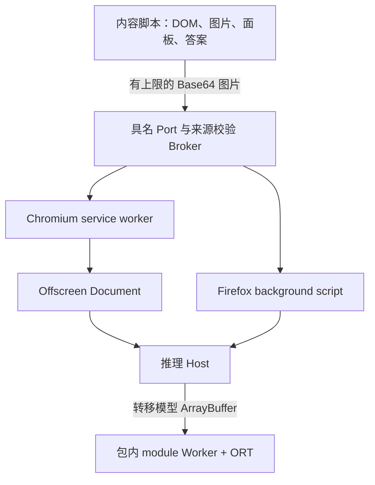

# 浏览器扩展

扩展版本来自 [package.json](../apps/extension/package.json)，当前为 `0.1.1`，清单、ZIP、artifact 与 Release 标签均由它派生。本文负责构建、安装、安全边界与验收；共享行为见[设置说明](usage/settings.md)，调用时序见[扩展运行时](architecture/extension-runtime.md)。

## Scope

| 目标             | 浏览器          | 最低版本            | 模型交付          | 验证边界                                    |
| ---------------- | --------------- | ------------------- | ----------------- | ------------------------------------------- |
| Chromium MV3     | Chrome、Edge    | Chromium 116        | remote / packaged | 独立执行精确最低桌面 major                  |
| Firefox MV3      | Firefox Desktop | Firefox 140         | remote / packaged | 独立执行精确最低桌面 major                  |
| 同一 Firefox ZIP | Firefox Android | Firefox Android 142 | remote / packaged | 内置模型 artifact 发布要求外部 Android 证据 |

Safari、其他移动浏览器、Manifest V2、商店签名和商店资料不在当前构建范围内。桌面 Firefox 版本高于 142 也不能证明 Android 兼容；远程桌面 Release 不声称 Android 已验证。不要在同一浏览器配置中同时启用用户脚本版和扩展版。

## Build modes

从仓库根目录执行，先按[验证手册](development/verification.md)准备依赖。

| 模式           | 命令                                                                  | 模型来源                                   | Key        |
| -------------- | --------------------------------------------------------------------- | ------------------------------------------ | ---------- |
| `remote`，默认 | `mise exec -- pnpm --filter @hv-pony-solver/extension build`          | `https://models.ngnl.host/yolo26n-640.ort` | 运行时需要 |
| `packaged`     | `mise exec -- pnpm --filter @hv-pony-solver/extension build:packaged` | 固定本地输入 `model/yolo26n-640.ort`       | 不使用     |

在扩展工作区也可用 `node scripts/build/build-extension.mjs --model-mode remote` 或 `--model-mode packaged`。模式固定于构建，不自动探测或回退。**每次重建 `apps/extension/dist/`，只保留所选模式产物。**

内置构建只接受固定输入，不接受路径/完整性覆盖或 Key 下载；清理旧 dist 前拒绝缺失、非普通文件、符号链接、长度不是 9,914,448 或 SHA-256 不符的模型。模型可从包中提取，完整性校验不提供保密性。

构建职责位于 `scripts/build/`。ZIP 有界流式压缩并增量计算哈希，固定排序和本地日历时间 `1980-01-01 00:00:00`，相同输入跨时区字节一致。构建器与 geckodriver 安装器清理前拒绝仓库、cwd、home 及其祖先，包括临时目录和解析符号链接后的路径。

## Build outputs and local loading

```text
apps/extension/dist/
├── chromium/
├── firefox/
├── hv-pony-solver-chromium-<version>.zip           remote
├── hv-pony-solver-firefox-<version>.zip            remote
├── hv-pony-solver-chromium-packaged-<version>.zip  packaged
├── hv-pony-solver-firefox-packaged-<version>.zip   packaged
├── *.zip.sha256
└── *.artifact.json
```

上表列出两种模式的并集，单次只生成两个 ZIP；`<version>` 当前为 `0.1.1`。目标目录与 ZIP 内部结构：

```text
<browser-target>/
├── manifest.json
├── build-manifest.json
├── background/background.js
├── content/content.js
├── options/
│   ├── options.html
│   ├── options.js
│   └── options.css
├── offscreen/                       仅 Chromium
│   ├── offscreen.html
│   └── offscreen.js
├── runtime/
│   ├── inference-worker.js          含精简 ORT glue
│   └── ort-wasm-simd-<sha256>.wasm
└── model/yolo26n-640.ort             仅 packaged
```

[`EXTENSION_PATHS`](../apps/extension/src/platform/extension-paths.ts) 统一维护 `background/background.js`、`content/content.js`、`options/options.html`、`options/options.js`、`options/options.css`、`offscreen/offscreen.html`、`offscreen/offscreen.js` 和 `runtime/inference-worker.js`。HTML 资源相对于页面目录解析，扩展 API URL 相对于包根解析。模型和 WASM 路径身份继续由 shared 清单维护。

`build-manifest.json` 记录 `modelDelivery` 与文件身份，packaged 包含模型长度/哈希；artifact 元数据绑定 ZIP。fixture 的 `expected.classId` 与 `expected.confidence` 是 E2E oracle。生成目录、ZIP、证据与本地模型不作为源码提交。

本地加载：

1. Chrome 打开 `chrome://extensions`，Edge 打开 `edge://extensions`，启用开发者模式，加载 `apps/extension/dist/chromium`。
2. Firefox 打开 `about:debugging#/runtime/this-firefox`，临时加载 `apps/extension/dist/firefox/manifest.json`。
3. 点击工具栏按钮进入 `options/options.html`；它是设置页，不是 popup。
4. remote 验证并保存 Key；packaged 直接使用包内模型。更新时完整替换构建目录、重新加载扩展并刷新游戏页。

## Permission matrix

| 目标/模式         | API 权限               | Host 权限              | Firefox 数据声明     |
| ----------------- | ---------------------- | ---------------------- | -------------------- |
| Chromium remote   | `storage`、`offscreen` | Hentaiverse 与模型服务 | 不适用               |
| Chromium packaged | `storage`、`offscreen` | Hentaiverse            | 不适用               |
| Firefox remote    | `storage`              | Hentaiverse 与模型服务 | `authenticationInfo` |
| Firefox packaged  | `storage`              | Hentaiverse            | `none`               |

Firefox remote 因向模型服务发送 Bearer Key 而声明 `authenticationInfo`。均不请求 `<all_urls>`、tabs、scripting、cookies、debugger 或 unlimited storage，不声明 `web_accessible_resources` 或图片资源。

CSP 为 `script-src 'self' 'wasm-unsafe-eval'; object-src 'none'; worker-src 'self'`，remote 追加 `connect-src 'self' https://models.ngnl.host`，packaged 为 `connect-src 'self'`。JS、module Worker、ORT glue 与 WASM 均随包分发；动态导入、远程可执行资产引用或哈希漂移使审计失败。remote 不含 `.ort`，packaged 必须且仅含清单指定模型。

审计锁定完整 MV3 清单：版本、后台、独立设置页、无 popup 的 action，以及内容脚本的 matches、exclude_matches、document_idle 和默认顶层隔离世界。拒绝 `optional_permissions`、`optional_host_permissions`、`externally_connectable`、`sandbox` 扩权；HTML 连同嵌套 template 拒绝内联脚本/事件、规范化后的 `javascript:`/`data:`/`vbscript:` URL、`srcdoc` 和 base URL 覆写。普通文本和合法本地资源不按可执行 URL 处理。

## Runtime architecture



Broker 在监听消息或调用 Host 前校验本扩展 ID 与实际 `sender.url`，不以 `sender.tab.url` 兜底。内容 Port 仅接受两个 Hentaiverse HTTPS 标准端口 origin，拒绝 URL 凭据；设置 Port 仅接受本扩展设置页及 query/hash。若提供 `sender.origin`，须与发送页面一致且非 opaque（`null`）；若提供 `frameId`，须为 0。字段缺省不免除 URL/扩展 ID 校验。

内容脚本不接收 Key 或模型字节。图片只在浏览器上下文间传递，原始图片最多 2 MiB，Base64 按编码后上限另行校验。HTTP Content-Type 验证后规范为小写基础 MIME，消息仍使用精确白名单。Firefox 隔离世界以 `FileReader.readAsDataURL()` 读 Blob，避免依赖可能被拒绝的 `Blob.arrayBuffer()`。

模型使用可转移 `ArrayBuffer`，不转 Base64 或分片；Worker 用 WASM Execution Provider 串行推理。两模式共用内容脚本：DOM、同源图片、历史、勾选与原生提交。

有历史时静默预热，首次安装按需加载，不提前消耗下载槽位。非静默 prepare/detect 活动期间，Host 阶段与断连消息才更新模型/会话状态；推理耗时由内容侧统计。

每个内容 Port 最多保留两个 detect 和两个并行 prepare；后台全局最多六个 detect、四个 prepare。这些计数随后台代际重置，不是整个浏览器会话的永久限额。取消只影响指定请求；尚未开始的 detect 立即从队列移除并释放图片，运行中的请求结算或终止后才执行下一项。

Offscreen claim 仅在同一 epoch/contextId 复用，等待者共享握手、独立取消；失败、超时、文档替换或后台重启后重新 claim，每次启动安排空闲回收。Firefox 直接持有 Host，不声明 `background.persistent`。细节见[扩展运行时](architecture/extension-runtime.md)。

## Model and runtime ownership

remote Host 持有下载器、模型与 Key 的独立 IndexedDB；有界下载通过长度/SHA-256 校验并缓存后才确认回执，详见[缓存专题](model-cache-strategy.md)。

packaged Host 不构造远程能力、不打开或修改原 Key、不声明模型 Host 权限。包内模型以 `force-cache`、`redirect: error` 读取，检查状态、十进制安全 Content-Length、流上限、精确长度与 SHA-256。模型/WASM 确定性完整性错误跨 Worker 保留永久分类，不重试损坏资产或远程回退。

## Storage and options

| 数据           | remote             | packaged        | 内容页可见性     |
| -------------- | ------------------ | --------------- | ---------------- |
| 模型字节       | 模型 IndexedDB     | 包内文件        | 不可见           |
| 模型 Key       | 独立秘密 IndexedDB | 不读、不改      | 不可见           |
| 普通设置与历史 | `storage.local`    | `storage.local` | 通过内存镜像读取 |

内容镜像只含应用命名空间，两个世界的历史供预热。初始化先监听再读快照，按 key 合并最早旧值与最新新值；5 秒超时、取消、超过 1024 个不同缓冲 key 或读取失败均清理监听器。最多四个前缀索引；预先取消不访问存储，销毁后拒绝启动排队写入与删除，已发起调用按真实结果结算，不能撤销已提交变更。

历史解析缓存按序列化值复用、返回副本，写后最终校对。裁剪只依据完整已提交快照，未决写入不挤掉旧记录，读取失败跳过删除。面板恢复与历史规则见[设置说明](usage/settings.md)，存储时序见[设置镜像](architecture/extension-runtime.md#普通设置镜像)。

remote 设置页在绑定处理器后才启用 Key 控件，已保存 Key 不回显：

| 操作         | 行为                                                                        |
| ------------ | --------------------------------------------------------------------------- |
| 验证并保存   | HEAD 验证，不计下载；IndexedDB 事务提交后才算保存成功                       |
| 查询下载次数 | 用已保存 Key 只读查询；关闭限制时显示“无次数限制（模型下载次数限制未开启）” |
| 下载模型     | 用已保存 Key 下载、验证、缓存和确认；有效缓存命中不重复计次                 |
| 清除 Key     | 删除 Key；不宣称撤销已经提交的事务或服务端确认                              |

验证/清除只清空点击后未编辑的输入，重输同样文字也算编辑。Key commit 独立驱动 Host 等待旧初始化取消后再通知 Broker，覆盖静默预热和其他 Port，就绪会话复用。调用方取消不撤销 commit；回滚或 Host 关闭后的迟到回调不通知，详见[凭证修订](architecture/extension-runtime.md#key-提交与凭证修订)。

页面销毁取消操作，错误保留实际 Host/HTTP/超时/浏览器原因。仅额度查询对 Port 瞬断重连一次，其他操作不重放。

packaged 设置页不打开 Key Port，Key 控件禁用并显示“当前版本已内置模型，无需配置模型 Key。”，普通设置仍可修改。

## Script and test entry points

包内 Node 测试使用 `node --test "scripts/**/*.test.mjs"`，覆盖 build、benchmark、browser、E2E、fixture 与 release 契约。脚本按这七个职责目录组织，日常使用包命令。

benchmark 按参数、统计、结果 schema、比较与 CSV 分模块，聚合入口只转发契约，runner 只编排采样。每次至少两个测量样本，`--samples 1` 在启动浏览器前拒绝。报告逐场景核对 invocation 总数、从零起连续且唯一的索引，以及每次 warmup/measured 数量与 config 完全一致；不能用满足最低采样量代替声明数量。入口与成本见[命令参考](development/commands.md)。

浏览器完整版本比较只删除末尾零：`140.15.0` 等同 `140.15`，不等同 `140.15.1`。最低支持和精确最低执行使用 [browser-support.mjs](../apps/extension/scripts/browser/browser-support.mjs) 的 major 策略。

## Validation and release evidence

先运行类型、单元测试和内容 fixture：

```bash
mise exec -- pnpm --filter @hv-pony-solver/extension typecheck
mise exec -- pnpm --filter @hv-pony-solver/extension test
mise exec -- pnpm --filter @hv-pony-solver/extension test:e2e:content
```

远程产物先构建，再执行 load-only；`test:e2e:chromium` 是 Chromium load-only 的别名：

```bash
mise exec -- pnpm --filter @hv-pony-solver/extension build
mise exec -- pnpm --filter @hv-pony-solver/extension test:e2e:chromium:load-only
mise exec -- pnpm --filter @hv-pony-solver/extension test:e2e:firefox:load-only
```

受保护环境已经注入 `KvKey`，且明确启用真实鉴权验收时，针对同一远程构建运行：

```bash
mise exec -- pnpm --filter @hv-pony-solver/extension test:e2e:chromium:authenticated
```

缺少 Key 必须失败。不要把 Key 写入命令行、日志或证据。鉴权模式拒绝非空 `DEBUG`/`PWDEBUG`；Key 输入失败只输出固定安全错误，不传递 Playwright call log、原异常或 cause。

内置模型是另一组产物，重新构建后再验收：

```bash
mise exec -- pnpm --filter @hv-pony-solver/extension build:packaged
mise exec -- pnpm --filter @hv-pony-solver/extension test:e2e:packaged
```

没有 canonical 模型时可运行根 `mise exec -- pnpm test:e2e:extension:packaged`，它构建确定性 fixture 并执行双浏览器验收。fixture 不证明 canonical 模型准确率，且会覆盖 dist。

| 检查                       | 证明内容                                                 | 不证明             |
| -------------------------- | -------------------------------------------------------- | ------------------ |
| 单元/构建测试              | 协议、权限、取消、资产、可重复归档                       | 浏览器实际执行     |
| content fixture            | 页面答题、消息、一次原生提交                             | 真实 ORT/模型      |
| Chromium/Firefox load-only | 远程包加载、普通设置；Firefox 核对当前 Key/额度/下载控件 | 鉴权下载与推理     |
| authenticated Chromium     | 有效 Key 下载校验后至少一次真实 detect，关闭随机回退     | 内置模型、商店发布 |
| packaged Chromium          | 校验 ZIP 与元数据，解压并只加载该临时树，两次成功推理    | Edge/商店验收      |
| packaged Firefox           | WebDriver 安装已校验的实际 ZIP，两个新会话成功推理       | AMO 签名、Android  |

内置证据 schema 2 绑定 archive 名称/长度/SHA-256、解压树哈希、模型、浏览器版本、成功结果类型、checkbox index 与 confidence。fixture 必须匹配 oracle，随机兜底无效；Chromium 加载受测 ZIP 解压树，Firefox 直接安装该 ZIP。

`REQUIRE_EXACT_MINIMUM_BROWSER=true` 要求真正运行 Chromium 116 或 Firefox Desktop 140，高版本不能替代。Chromium 116 在 Xvfb 下使用 `PACKAGED_E2E_HEADLESS=false`，该变量只接受 true/false。Firefox 需要 geckodriver（或 `GECKODRIVER_PATH`）及 openssl，并清理自建证书、代理和会话。CI 固定 geckodriver `0.37.1` 与压缩包 SHA-256；安装器在 60 秒总期限内最多尝试三次，仅重试网络和 HTTP 408/429/5xx，归档、哈希、路径或版本错误直接失败。

### Firefox Android 142 external release gate

CI 不自动运行 Android。独立 harness 须在 Android Firefox major 142 安装同一 canonical ZIP，关闭随机回退并成功推理至少一次。外部 run 的 artifact `hv-pony-solver-firefox-android-142-evidence` 内含 `firefox-android-142-evidence.json`，`kind` 为 `firefox-android-142-packaged-e2e`，记录设备、Android/浏览器版本、模型、精确 ZIP 和成功观察。

内置发布设置 `publish_extension_artifact=true` 与 `firefox_android_e2e_run_id`，在 canonical 构建 job 内校验成功 run、可信 workflow/事件/commit 和本地同一 ZIP。缺证据、版本/归档不符或随机回退均阻止完整 ZIP 的首次上传；缺 `PACKAGED_MODEL_URL` 会跳过 canonical 门禁并阻止内置发布。

桌面 attestation 同时校验解压树 SHA-256 和正安全整数 `tree.fileCount`；缺失、非整数或越界文件数不能作为发布证据。canonical 下载器按精确长度分配自有缓冲并即时复制每块，流源复用分块内存也不能改变已读取内容；全部字节与 SHA-256 验证后才落盘。

### GitHub desktop Release

在 main 手动设置 `publish_extension_release=true`，创建 `extension-v<version>`（当前 `extension-v0.1.1`），附已测试的远程双浏览器 ZIP、SHA-256 与 artifact 元数据。已有标签或非 main 被拒绝，只有最终发布 job 有写权限。

两类扩展发布均要求本次 CodeQL job 成功、仓库检查、桌面 smoke、内置 fixture、最低桌面版本与受保护远程推理门禁。`production-model-smoke` 环境提供 `KV_KEY`；缺少凭据或未启用会跳过鉴权并阻止发布，不能以 HEAD 验证替代 detect。CodeQL 执行成功不代表没有安全告警。

普通 push/PR 不发布；job 间传递的完整 ZIP 也须在显式授权及全部所需门禁通过后上传。GitHub Release 不等同商店签名或 Android 验收。全部输入、工作流与交付边界见[CI 与发布](development/releases.md)。
